# Ekte Mat Online – Software design (Oblig 4)

Prepared: 2026-10-22. Requirements: see [backlog.md](backlog.md) (US = user story, K = conflict).
Every diagram exists as Mermaid source (`design/*.mmd`, rendered by GitHub) and as a PNG for the report.
To re-render a PNG: `npx @mermaid-js/mermaid-cli -i design/<name>.mmd -o design/<name>.png`.

## 1 Use case diagram

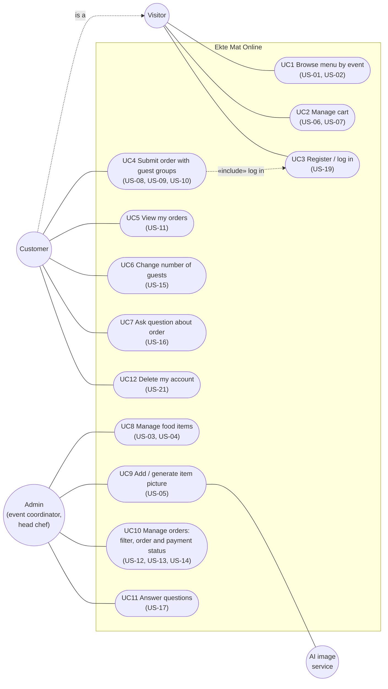


**How we used it:** to agree on scope and on who does what. Each use case lists the user stories it covers. We used it to split the work between the three blueprints: UC1–UC4 → `shop`, UC3, UC5–UC7 and UC12 → `account`, UC8–UC11 → `admin`.

## 2 Domain class diagram

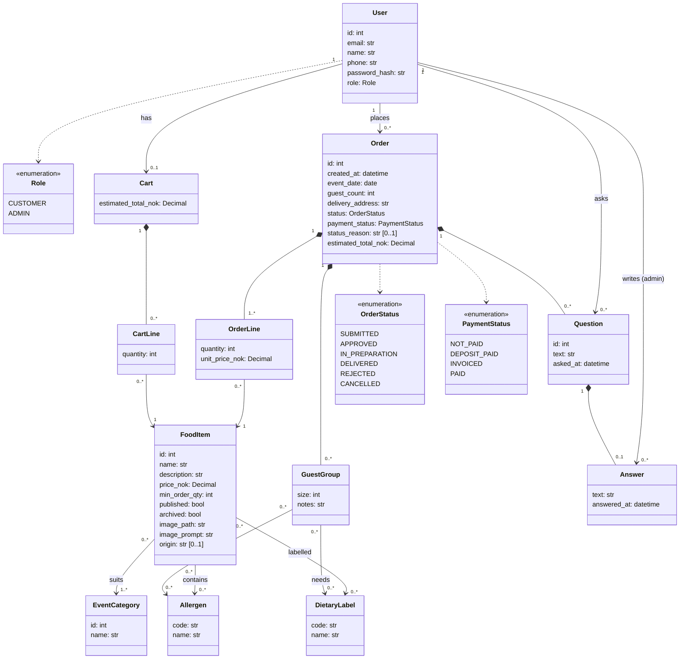

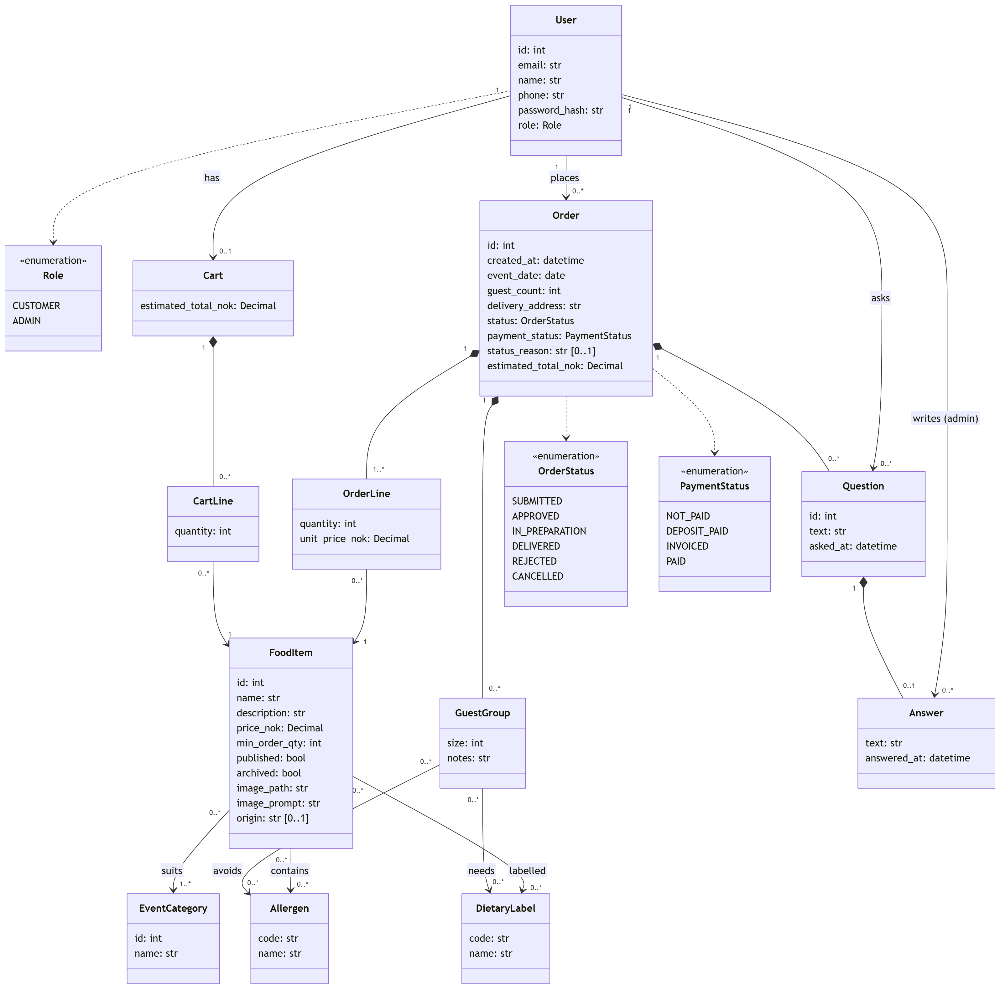

**How we used it:** this is the source for the domain classes in `app/models/` and for the repository methods. Decisions behind it:

- **OrderLine copies `unit_price_nok`**, so a later price change does not alter old orders. Food items are archived (`archived = true`), never deleted (US-03).
- **GuestGroup has no name field.** Allergy data is stored per group only (GDPR, NFR-04).
- **Order status and payment status are two separate enumerations**, as the assignment requires (A3). Each has its own state machine.
- **Cart is a domain class but is not persisted.** It lives in the Flask session until the order is submitted.
- **Answer is 0..1 per Question.** Ekte Mat gives one answer, and the customer can ask a new question.
- There are no controllers, DTOs or methods in the diagram: it is a domain model, not a design of the implementation.

## 3 Sequence diagram – customer submits an order (C3)

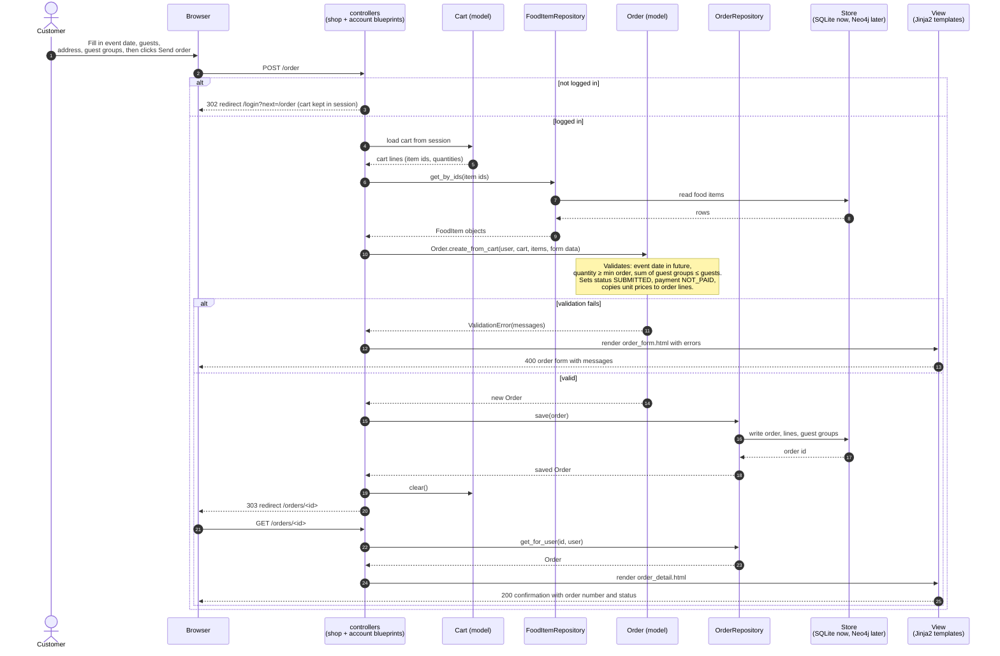

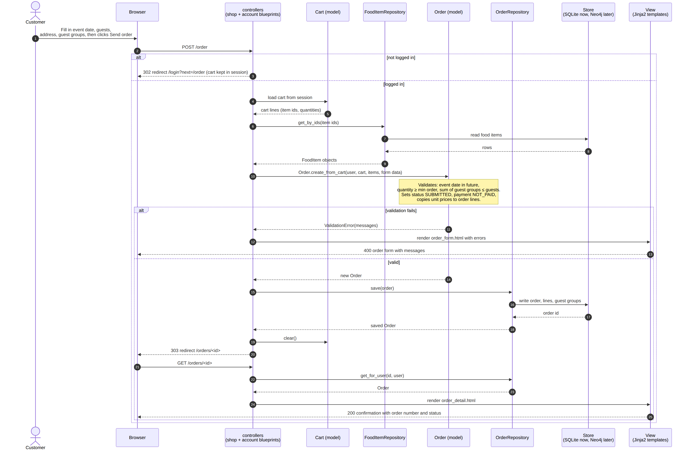

**How we used it:** to show how one request moves through the MVC layers and to decide where validation belongs. It belongs in the **model** (`Order.create_from_cart`), not in the controller, so the same rules apply to future API or admin forms. It also gave us the repository methods we need (`get_by_ids`, `save`, `get_for_user`) and the test cases for US-07, US-08 and US-09.

## 4 State machine – order status

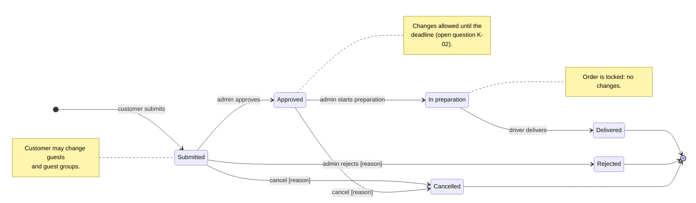


**How we used it:** implemented as an allowed-transitions table in `Order` (e.g. `ALLOWED = {SUBMITTED: {APPROVED, REJECTED, CANCELLED}, ...}`). The admin order page shows only the buttons for valid next states, and an invalid transition raises an error (US-13). The deadline for guest changes is still open (K-02).

## 5 State machine – payment status

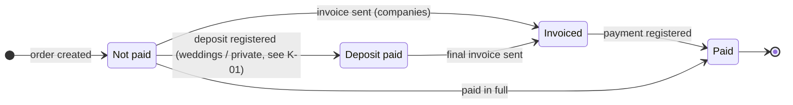

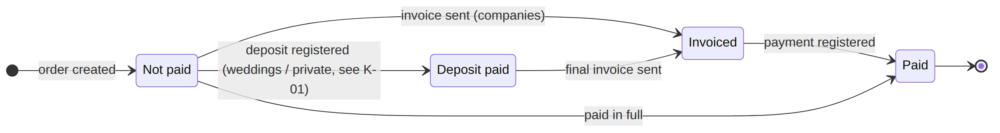

**How we used it:** this machine is independent of the order status. It supports both payment models from conflict K-01: a deposit for weddings and private events, and an invoice for companies.

## 6 MVC architecture sketch

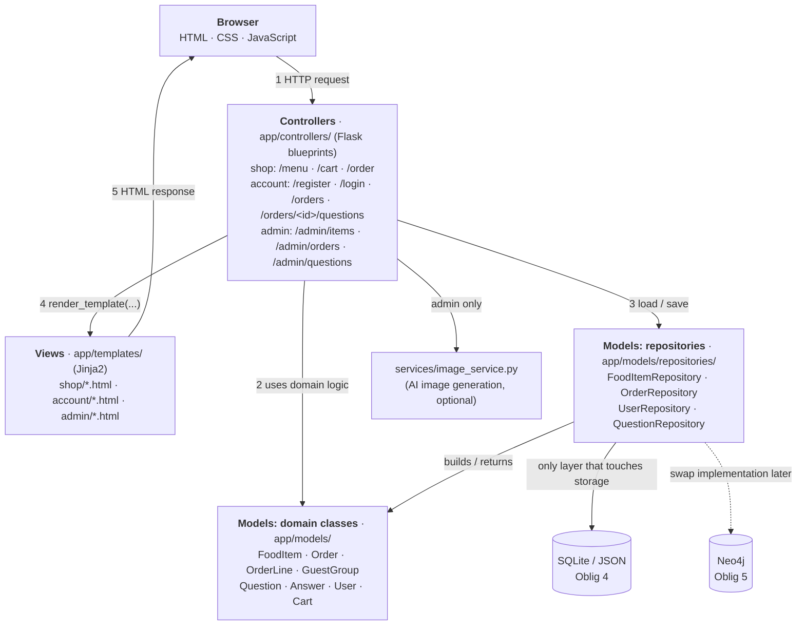

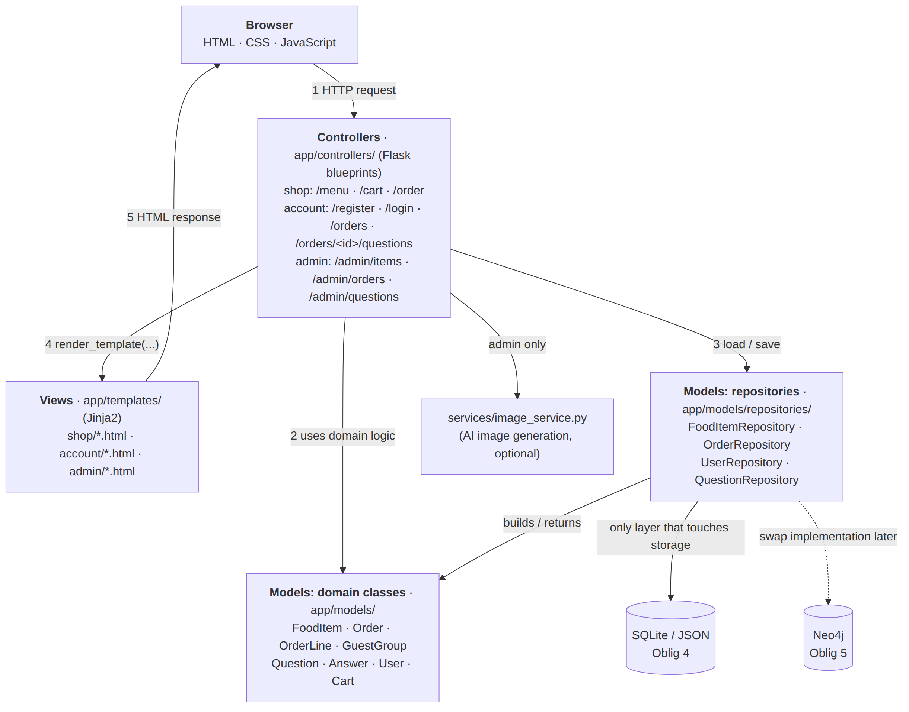

Planned folder structure:

```
ektemat-online/
├── CLAUDE.md
├── README.md
├── .env.example            # SECRET_KEY=..., IMAGE_API_KEY=...  (real .env is git-ignored)
├── app/
│   ├── __init__.py         # create_app(), registers blueprints
│   ├── controllers/        # C: shop.py, account.py, admin.py (blueprints)
│   ├── models/             # M: domain classes (food_item.py, order.py, ...)
│   │   └── repositories/   # M: base.py (interfaces), sqlite_*.py now, neo4j_*.py in Oblig 5
│   ├── services/           # image_service.py (optional AI images)
│   ├── templates/          # V: shop/, account/, admin/ (Jinja2)
│   └── static/             # css/, js/, uploads/
├── seed.py                 # synthetic food items, one admin, test customers
├── tests/
└── docs/
    ├── backlog.md
    ├── design.md
    ├── design/             # *.mmd + *.png
    └── plans/              # plan-mode plans, one file per feature
```

**How we used it:** to enforce NFR-02. Controllers only call repository interfaces, so the SQLite implementation can be replaced with Neo4j in Oblig 5 without touching controllers or templates. We also gave the layout to Claude Code in `CLAUDE.md`.

## 7 Graph data model (preparation for Neo4j, Oblig 5)

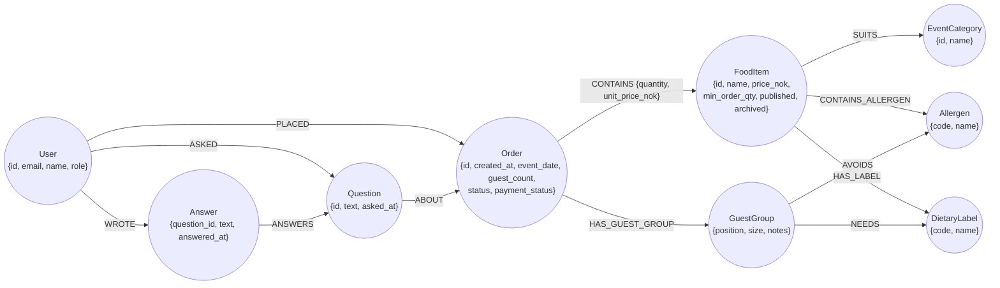

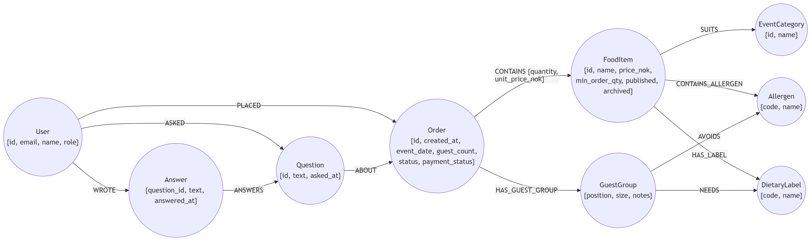

**How we used it:** to check that the domain model maps cleanly to a graph. OrderLine becomes the relationship `CONTAINS {quantity, unit_price_nok}`. Allergen and DietaryLabel become shared nodes, which makes queries like "all of tomorrow's orders with guests who avoid nuts" easy for the optional kitchen view (US-22). Cart is not stored. **Implementation (Oblig 5):** `id` is our own integer property from a `(:Sequence {name, value})` counter, never Neo4j's internal id, because URLs and the session use integer ids. Unique constraints on `User.email`, `User.id`, `FoodItem.id`, `EventCategory.id/name`, `Allergen.code` and `DietaryLabel.code`. `price_nok`, `unit_price_nok` and `estimated_total_nok` are stored as text so amounts stay exact. An order with its `CONTAINS` relationships and guest groups is saved in one transaction. `GuestGroup.position` keeps the order the customer entered the groups in (a graph has no order); guest groups have no name field (NFR-04). `Answer.question_id` has a unique constraint so the database itself allows at most one answer per question. Constraints also cover `Order.id` and `Question.id`.

## 8 Consistency check

| Check | Result |
|---|---|
| Every use case traces to at least one user story | OK: UC1–UC12 all list their US IDs. |
| Every Must/Should story appears in a use case | OK, except **US-20** (admin access) and NFRs, which are cross-cutting and implemented as a `@admin_required` decorator, not a use case. EP6 (Could) is out of scope for the diagram. |
| Every model class in the sequence diagram exists in the class diagram | OK: Cart, FoodItem, Order (+ OrderLine and GuestGroup created inside). Controllers, repositories, store and views are architecture elements, shown in the MVC sketch. |
| The OrderStatus enumeration matches the state machine | OK: 6 values, 6 states. |
| The PaymentStatus enumeration matches the state machine | OK: 4 values, 4 states. |
| Every assignment requirement C1–C5 and A1–A4 is covered | C1 US-01/02 · C2 US-06/07 · C3 US-08/09/19 · C4 US-11 · C5 US-16 · A1 US-03/04 · A2 US-05 · A3 US-12/13/14 · A4 US-17 |
| Graph model matches the class diagram | OK. Intentional differences: Cart is not stored, and OrderLine is a relationship. |
